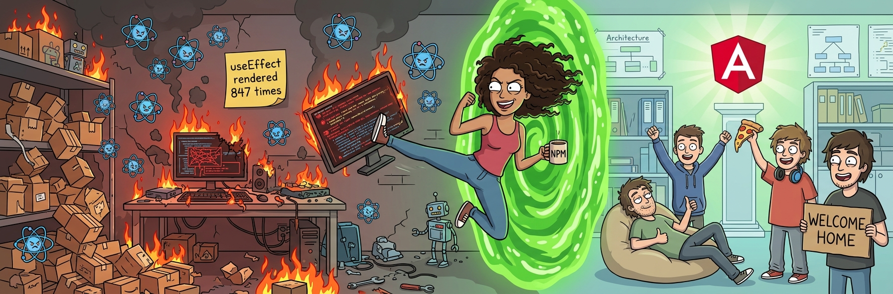

<h1 align="center">Olá, eu sou a Ale 👋</h1>
<h3 align="center">Desenvolvedora Frontend | Defensora Oficial do Angular | Atualmente Refém do React 🥲</h3>



<p align="center">
  
  
  
</p>

---

## 🧠 Sobre mim

- 🔭 Atualmente trabalhando em projetos React, contra a minha vontade, sob protesto formal e com lágrimas nos olhos.
- 🏛️ Mas meu coração continua em projetos que **já nascem com estrutura**, não com uma pasta `src/` e uma oração.
- 🌱 Aprendendo a ter paciência com colegas que ainda estão escolhendo qual lib de roteamento usar.
- 💬 Me pergunte sobre: injeção de dependência, módulos, RxJS, e por que eu durmo tranquilo à noite.
- ⚡ Fun fact: enquanto o time do React discutia se usava Redux, Zustand, Jotai, Recoil ou Context API, eu já tinha entregado a feature.

---

## 🥊 Angular vs React: um estudo científico e totalmente imparcial*

| Situação | 🅰️ Angular | ⚛️ React |
|---|---|---|
| Começar um projeto novo | `ng new` e pronto | 3 dias de reunião pra escolher 47 bibliotecas |
| Roteamento | Já vem | "Qual versão do router a gente tá usando mesmo?" |
| Formulários | Reactive Forms, validação, tudo nativo | `npm install` + fé |
| Requisições HTTP | `HttpClient` com interceptors | "Axios? Fetch? React Query? TanStack? SWR?" |
| Gerenciamento de estado | Services + RxJS / Signals | Uma nova lib a cada sprint |
| Testes | Configurado de fábrica | Configura o Jest, quebra o Babel, chora |
| Arquitetura | Padrão pra todo mundo | Cada dev tem a sua, e todas estão "certas" |
| Escalabilidade | Projeto com 300 componentes continua organizado | Projeto com 300 componentes vira arqueologia |
| Onboarding de dev novo | "Segue o padrão do Angular" | "Então... aqui a gente faz meio diferente" |

<sub>*Estudo conduzido por mim, com amostra de 1 pessoa (eu), revisado por pares (também eu).</sub>

---

## 📜 Os 5 Mandamentos do Dev Angular

1. **Não usarás `any`** em vão.
2. **Honrarás o CLI**, pois ele gera teus componentes, services e testes antes mesmo de tu pedires.
3. **Farás `unsubscribe`** de teus Observables, ou usarás o `async` pipe, e serás abençoado.
4. **Não cobiçarás a lib do próximo**, pois tudo que precisas já está no framework.
5. **Lembrarás que "é só uma biblioteca"** é exatamente o problema.

---

## 🗣️ Frases que já ouvi do time React

> "React é só uma biblioteca, por isso é mais flexível."

Sim. Tão flexível que cada projeto parece ter sido feito por uma empresa diferente. 🙃

> "Angular tem muito boilerplate."

Chama-se **organização**, meu amigo. Tipo gaveta de talheres. Você pode jogar tudo numa caixa, mas vai se furar procurando a colher.

> "Mas o React tem uma comunidade enorme!"

Tem sim. E ela precisou criar 12 soluções diferentes pro mesmo problema, porque o React não trouxe nenhuma. 🤝

> "useEffect é simples, é só entender o array de dependências."

*Renderizou 847 vezes enquanto eu lia essa frase.*

---

## 📊 Minhas estatísticas

```
Horas economizadas por não escolher libs:     ████████████████████ 100%
Discussões sobre Angular vs React vencidas:   ██████████████████░░  90%
Discussões que o time React admitiu derrota:  ░░░░░░░░░░░░░░░░░░░░   0%
Vezes que falei "no Angular isso já vem":     ████████████████████ 9999+
```

---

## 🛠️ Minha stack

<p>
  
  
  
  
  
  
</p>

---


## 🎭 Plot twist

Depois de tudo isso, adivinha qual framework a empresa escolheu pros projetos novos?

**React.** ⚛️🔫🅰️

Pois é. Então agora eu sigo assim:

- 📦 Instalando 23 libs pra fazer o que o Angular fazia de fábrica
- 🧘 Respirando fundo toda vez que alguém pergunta "e o estado, fica onde?"
- 🕵️ Criando `services/` escondida dentro do projeto React, pra matar a saudade
- 📝 Escrevendo `useEffect` com a mesma alegria de quem preenche formulário de cartório
- 🗓️ Contando os dias pro próximo projeto Angular, igual criança esperando o Natal

```
Status atual:  [ React ] ████████░░░░░░░░░░░░  aceitação: 40%
               [ Angular] ████████████████████  amor eterno: 100%
```

> "Não é porque eu uso React que eu concordo com React." — Eu, em terapia

---

## 🕊️ Nota de paz

Brincadeiras à parte, React é uma ótima ferramenta e o time de lá é gente boa demais.

Eles só estão... **errados**. 😌

E agora eu tô aqui, do lado deles, provando que dá pra escrever React organizado... **porque eu escrevo como se fosse Angular.** 😏

Quando o projeto crescer e ninguém mais souber onde fica o estado global, minha porta (e meu `app.module.ts` guardado com carinho) estará sempre aberta. ❤️🅰️

---

<p align="center">
  <i>"Um framework completo não é boilerplate. É consideração com o dev do futuro."</i><br>
  — Eu, em toda daily
</p>
